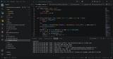
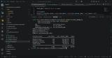

# UK E-Commerce Revenue Leakage & CRM Ingestion Pipeline

**An end-to-end data pipeline and analytics layer that ingests raw e-commerce transaction data, enforces a strict data contract, identifies revenue leakage drivers, and produces a governed dataset ready for forecasting and business intelligence reporting.**

> **Privacy Guardrails:** All account names, customer identifiers, and transaction values are 100% synthetic data of identical structure. The pipeline architecture, SQL logic, and analytical framework reflect real-world commercial and revenue operations practice.

---

## Business Challenge

E-commerce and CRM platforms frequently accumulate transaction records with missing attribution, unverified deal stages, and lost deals that carry no recorded reason — making it impossible to diagnose where revenue is leaking or forecast future pipeline with confidence.

This project addresses three core operational problems:

1. **Revenue leakage** — closed-lost deals with no recorded friction driver cannot be analysed or remediated
2. **Forecast unreliability** — open pipeline weighted without accounting for friction signals overstates expected revenue
3. **CRM data debt** — missing channel, region, and category attribution compounds reporting inaccuracy over time

---

## Technical Architecture

The pipeline runs in two sequential phases:

### Phase 1 — Python Ingestion & Data Cleaning
Raw transaction logs (`data/raw/raw_transaction_logs.csv`) are ingested and cleaned using Python and Pandas. The output is a structured, standardised CSV (`data/processed/clean_crm_migration.csv`) that serves as the single source of truth for the analytical layer.

### Phase 2 — SQLite Relational Analytics Layer
The cleaned data is loaded into a governed SQLite database enforcing a strict data contract through `CHECK` constraints on every column — invalid records are rejected at load time and cannot reach reporting silently. The staging-to-governed table transform applies explicit casting, `COALESCE` defaults, and business rule enforcement before any query runs.

**Data Contract Rules (enforced at load):**
- Transaction IDs must match format `TXN######`
- Customer UUIDs must be valid 36-character UUIDs
- Revenue must be a positive decimal
- Deal Stage restricted to `Closed-Won`, `Closed-Lost`, `Open`
- Friction Reason restricted to `Response Delay`, `Warehouse Stockout`, `Navigation Friction`, `Unattributed`
- Leakage value must equal deal value on lost deals and zero on all others

Records failing these rules are quarantined (`data/quarantine/rejected_records.csv`) rather than silently loaded.

---

## Analytical Queries

### Query 1 — Revenue Leakage Audit
Breaks down closed-lost revenue and deal counts by operational friction driver. Calculates each driver's share of total leakage and average response times where applicable — giving RevOps a prioritised view of where deals are being lost and why.

### Query 2 — Active Forecasting Pipeline
Produces a probability-weighted revenue forecast by month. Open deals are assigned a base win probability (40%) that is further discounted when the deal already exhibits a friction signal — the same signals historically associated with closed-lost outcomes. This surfaces at-risk pipeline before deals close.

| Friction Driver | Probability Multiplier Applied |
| :--- | :--- |
| Response Delay | 50% of base |
| Warehouse Stockout | 40% of base |
| Navigation Friction | 60% of base |

### Query 3a — Data Hygiene Scorecard
Runs 10 automated validation checks across the full dataset and returns a `PASS`, `WARN`, or `FAIL` status per rule. Designed as an executive-level summary of CRM data health.

### Query 3b — Data Hygiene Detail
Record-level remediation worklist. Every transaction failing one or more hygiene rules is returned with its specific failure flags (`NO_CHANNEL`, `NO_REGION`, `LOST_NO_CAUSE`, `STAGE_INFERRED`, etc.) for CRM owners to action directly.

---

## Key Outcomes

- **826 records quarantined** at the data contract boundary — blocked from reaching analytics or reporting
- **10-rule automated hygiene framework** covering duplicates, missing attribution, unverified stages, and unattributed lost deals
- **Friction-adjusted forecasting** that discounts at-risk open pipeline rather than treating all open deals equally
- **Record-level remediation output** giving CRM teams an actionable worklist rather than a summary report

---

## Visual Evidence

*826 records quarantined at the data contract boundary on load.*

*Closed-lost deal distribution by friction driver and response time.*

---

## Project Assets & Files

| Asset | Location | Description |
| :--- | :--- | :--- |
| `raw_transaction_logs.csv` | `data/raw/` | Raw source transaction data |
| `clean_crm_migration.csv` | `data/processed/` | Phase 1 cleaned output |
| `rejected_records.csv` | `data/quarantine/` | Records failing data contract |
| `sql_1_revenue_leakage_audit.csv` | `data/processed/` | Query 1 results |
| `sql_2_active_forecasting_pipeline.csv` | `data/processed/` | Query 2 results |
| `sql_3a_data_hygiene_scorecard.csv` | `data/processed/` | Query 3a results |
| `sql_3b_data_hygiene_detail.csv` | `data/processed/` | Query 3b results |
| `analytical_queries.sql` | `sql/` | Full SQLite analytics layer |

---

## Tech Stack

Python (Pandas) · SQLite 3.35+ · Advanced SQL (CTEs, window functions, CHECK constraints) · Revenue Operations · Data Contract Design · CRM Data Governance
