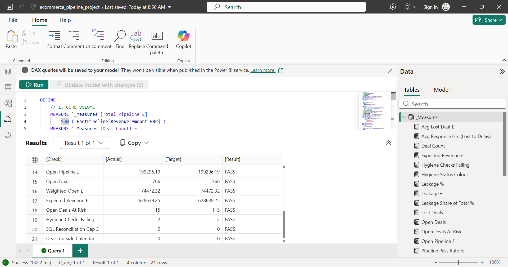

# UK E-Commerce Revenue Leakage & CRM Ingestion Pipeline

**An end to end data pipeline and analytics layer that ingests raw e-commerce transaction logs, enforces a strict data contract, identifies the operational drivers of revenue leakage, and delivers a reconciled Power BI semantic model ready for forecasting and executive reporting.**

> **Privacy Guardrails:** All account names, customer identifiers and transaction values are fully synthetic, generated with the same structure as real CRM exports. The pipeline architecture, SQL logic, DAX model and analytical framework reflect real world commercial and revenue operations practice.

---

## Headline Findings (synthetic dataset, 5,100 raw records)

| Metric | Result |
|---|---|
| Clean pipeline value | **£1,178,155** across 4,274 valid deals |
| Revenue lost to Closed-Lost deals | **£424,692** (36.0% leakage rate, 1,480 lost deals) |
| Largest single leakage driver | **Response Delay: £161,266** (38.0% of all leakage) |
| Average first response on deals lost to delay | **86.4 hours** against a 24 hour SLA |
| Expected revenue (won plus friction weighted open pipeline) | **£628,639** |
| Open deals already showing friction | **115** |
| Revenue recoverable by halving response delay losses | **£80,633** |
| Records passing the data contract | **83.8%** (826 quarantined with audit codes) |

**Interpretation:** fixing response time alone addresses the largest leakage bucket. That is a process and staffing fix rather than a technology spend, which makes it the strongest early recommendation the data supports.

---

## Business Challenge

E-commerce and CRM platforms frequently accumulate transaction records with missing attribution, unverified deal stages and lost deals that carry no recorded reason. That makes it impossible to diagnose where revenue is leaking or to forecast future pipeline with confidence.

This project addresses three core operational problems:

1. **Revenue leakage:** closed lost deals with no recorded friction driver cannot be analysed or remediated
2. **Forecast unreliability:** open pipeline weighted without accounting for friction signals overstates expected revenue
3. **CRM data debt:** missing channel, region and category attribution compounds reporting inaccuracy over time

---

## Technical Architecture

The pipeline runs in three sequential phases, and every phase reconciles exactly to the one before it.

### Phase 1: Python Ingestion & Data Cleaning
Raw transaction logs (`data/raw/raw_transaction_logs.csv`) are parsed with Python, Regex and Pandas. The source deliberately mirrors a messy real export: 5,000 log lines plus 100 duplicate postings, 8 date formats, 7 currency styles, inconsistent UUID formats, missing fields and truncated lines. Each line is parsed into 14 structured CRM fields, strictly typed, and classified by friction driver. The output (`data/processed/clean_crm_migration.csv`) is the single source of truth for every downstream layer.

### Phase 2: SQLite Relational Analytics Layer
The cleaned data is loaded into a governed SQLite database that enforces a strict data contract through `CHECK` constraints on every column, so invalid records are rejected at load time and can never reach reporting silently. The staging to governed transform applies explicit casting, `COALESCE` defaults and business rule enforcement before any query runs.

**Data Contract Rules (enforced at load):**
- Transaction IDs must match format `TXN######`
- Customer UUIDs must be valid 36 character UUIDs
- Revenue must be a positive decimal
- Deal Stage restricted to `Closed-Won`, `Closed-Lost`, `Open`
- Friction Reason restricted to `Response Delay`, `Warehouse Stockout`, `Navigation Friction`, `Unattributed`
- Leakage value must equal deal value on lost deals and zero on all others

Records failing these rules are quarantined (`data/quarantine/rejected_records.csv`) with their original raw line and a coded rejection reason, rather than silently loaded.

### Phase 3: Power BI Semantic Model & Reconciliation
The governed outputs feed a Power BI semantic model built on a star schema:

- **FactPipeline** as the central fact table, filtered by a dedicated **Calendar** dimension (one to many, single direction)
- **Quarantine, Hygiene, HygieneDetail and SQL_LeakageAudit** held as standalone audit tables, so data quality reporting can never distort revenue totals
- A dedicated **_Measures** table holding 24 DAX measures covering leakage, SLA performance, friction weighted forecasting and data quality
- A **Recovery Rate** what if parameter that models how much leaked revenue a response time fix would recover

Leakage and forecast figures are rebuilt in DAX from row level data rather than read from static SQL summaries, so every number responds to Channel, Product Category and Month filters.

**Reconciliation as a built in control:** `powerbi/load_and_reconcile.dax` loads every measure and tests 21 figures against the Python and SQL baseline in a single query. All 21 pass to the penny, including a **zero gap against the SQL leakage audit** and **full Calendar coverage of every deal**. The test can be rerun after any model change to prove nothing has broken.

---

## Analytical Queries

### Query 1: Revenue Leakage Audit
Breaks down closed lost revenue and deal counts by operational friction driver. Calculates each driver's share of total leakage and average response times where applicable, giving RevOps a prioritised view of where deals are being lost and why.

### Query 2: Active Forecasting Pipeline
Produces a probability weighted revenue forecast by month. Open deals are assigned a base win probability (40%) that is further discounted when the deal already shows a friction signal, the same signals historically associated with closed lost outcomes. This surfaces at risk pipeline before deals close.

| Friction Driver | Probability Multiplier Applied |
| :--- | :--- |
| Response Delay | 50% of base |
| Warehouse Stockout | 40% of base |
| Navigation Friction | 60% of base |

### Query 3a: Data Hygiene Scorecard
Runs 10 automated validation checks across the full dataset and returns a `PASS`, `WARN` or `FAIL` status per rule. Designed as an executive level summary of CRM data health.

### Query 3b: Data Hygiene Detail
Record level remediation worklist. Every transaction failing one or more hygiene rules is returned with its specific failure flags (`NO_CHANNEL`, `NO_REGION`, `LOST_NO_CAUSE`, `STAGE_INFERRED`, etc.) for CRM owners to action directly.

---

## Key Outcomes

- **826 records quarantined** at the data contract boundary, blocked from reaching analytics or reporting
- **10 rule automated hygiene framework** covering duplicates, missing attribution, unverified stages and unattributed lost deals
- **Friction adjusted forecasting** that discounts at risk open pipeline rather than treating all open deals equally
- **Record level remediation output** giving CRM teams an actionable worklist rather than a summary report
- **Three layer reconciliation:** Python, SQL and Power BI agree to the penny across 21 tested figures

---

## Visual Evidence

*826 records quarantined at the data contract boundary on load.*

*Closed lost deal distribution by friction driver and response time.*

*DAX reconciliation query: all 21 Power BI figures match the Python and SQL baseline to the penny.*

---

## Project Assets & Files

| Asset | Location | Description |
| :--- | :--- | :--- |
| `raw_transaction_logs.csv` | `data/raw/` | Raw source transaction data |
| `clean_crm_migration.csv` | `data/processed/` | Phase 1 cleaned output |
| `rejected_records.csv` | `data/quarantine/` | Records failing data contract |
| `sql_1_revenue_leakage_audit.csv` | `data/processed/` | Query 1 results |
| `sql_2_active_forecasting_pipeline.csv` | `data/processed/` | Query 2 results |
| `sql_3a_data_hygiene_scorecard.csv` | `data/processed/` | Query 3a results |
| `sql_3b_data_hygiene_detail.csv` | `data/processed/` | Query 3b results |
| `pipeline_engine.py` | `src/` | Phase 1 Regex ingestion engine and data contract |
| `db_loader.py` | `src/` | Builds the governed SQLite database and exports every query |
| `preflight_check.py` | `src/` | Environment and file checks run before the Power BI build |
| `analytical_queries.sql` | `sql/` | Full SQLite analytics layer |
| `measures.dax` | `powerbi/` | DAX measure library and Calendar definition |
| `load_and_reconcile.dax` | `powerbi/` | One pass measure load and 21 point reconciliation test |
| `nexus_theme.json` | `powerbi/` | Report theme: slate grey palette, red reserved for leakage and risk |

---

## Tech Stack

Python (Pandas, Regex) · SQLite 3.35+ · Advanced SQL (CTEs, window functions, CHECK constraints) · Power BI · DAX · Star Schema Modelling · Revenue Operations · Data Contract Design · CRM Data Governance
